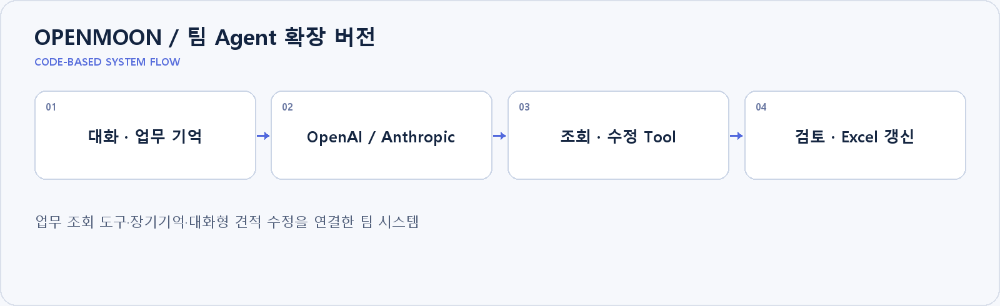

# OPENMOON / 팀 Agent 확장 버전

**업무 조회 도구·장기기억·대화형 견적 수정을 연결한 팀 시스템**

## 프로젝트와 담당 범위

초기 MVP 이후의 팀 시스템을 정리한 저장소입니다. 저는 전체 업무 상담 Agent와 대화 맥락·견적 변경 흐름을 보완했습니다. 회사 지식·장기기억·과거 견적·단가표의 근거 순서를 두고 Tool 결과를 확인해 응답합니다. 견적 Agent는 발송을 수행하지 않으며 담당자 승인 영역으로 남깁니다. OpenAI 전체 상담 경로에는 웹 검색을 제공합니다.

## 구현 근거

[Agent 반복 실행](backend/app/services/agent_service.py) · [업무 Tool](backend/app/services/agent_tools.py) · [대화 요약](backend/app/services/conversation_summary_service.py)

기존 설치·구현 문서는 [README_DETAILS.md](README_DETAILS.md)에 보존했습니다.
